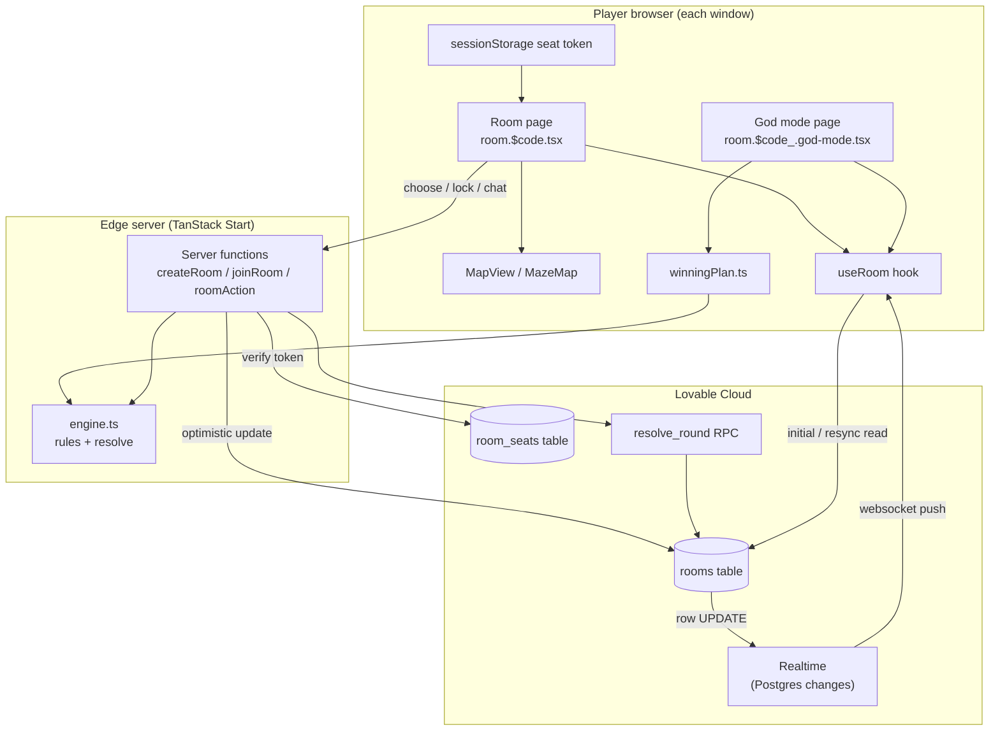
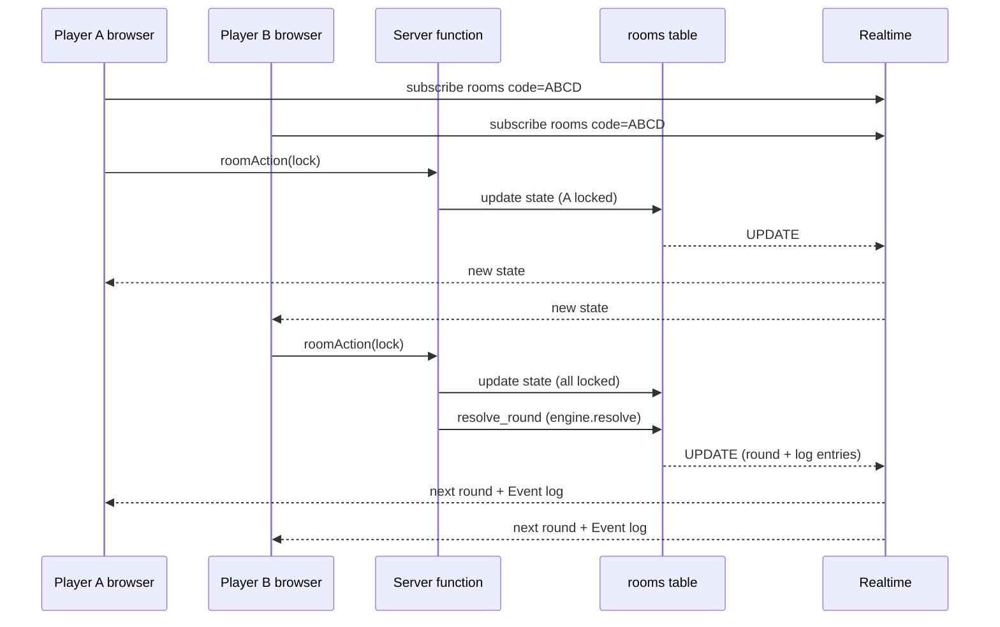

# Night Orchard — Architecture

Night Orchard is a cooperative, turn-based multiplayer browser game. Players join a room with a 4-letter code, choose and lock one action per round, and the server resolves the round when everyone has locked. No login is needed.

## Tech stack

| Layer | Technology | Role |
| --- | --- | --- |
| Framework | **TanStack Start v1** (React 19, Vite 7) | SSR pages, file-based routing (`src/routes`), server functions |
| UI | **Tailwind CSS v4**, shadcn/ui (Radix), lucide-react | Retro CRT styling, dialogs, icons |
| Custom art | SVG + 12x12 pixel grids | Maze map (`MazeMap.tsx`), lantern icons (`LanternIcon.tsx`) |
| Game rules | Pure TypeScript (`src/game/engine.ts`) | Legality checks and round resolution, unit-tested |
| Solver | Pure TypeScript (`src/game/winningPlan.ts`) | God mode per-player winning plan |
| Server logic | TanStack `createServerFn` (`src/game/room.functions.ts`) | The only writer of game state |
| Backend | **Lovable Cloud** (Postgres database + Realtime) | Stores rooms/seats, broadcasts changes |
| Hosting | Edge runtime (Cloudflare Workers) | Serves SSR and server functions at night-orchard.lovable.app |
| Tests | Vitest + Testing Library | Engine, planner, room hook, routing |

## Data model

- `rooms` — one row per game: `code`, `state` (whole `GameState` JSON), `round`, `updated_at`. Publicly readable so any browser can subscribe.
- `room_seats` — secret seat tokens per player. Service-role only; browsers never read it.
- `resolve_round` RPC — round-guarded write so a round is resolved exactly once.

Each browser window keeps its seat token in `sessionStorage`, so several windows can play as different players.

## Component diagram

## How every player's browser stays updated

Live updates use **Lovable Cloud Realtime (Postgres Changes over WebSockets)**:

1. Each window's `useRoom` hook (`src/game/useRoom.ts`) reads the room row once, then opens a Realtime channel subscribed to `UPDATE` events on `rooms` filtered by `code=eq.<CODE>`.
2. Any player action calls a server function, which writes the new state to the `rooms` row.
3. The database emits the change; Realtime pushes the new row to every subscribed window over its WebSocket.
4. The hook ignores snapshots older than the last `updated_at` it saw (protects against delayed reads), then re-renders the page.
5. When the channel (re)connects it re-reads the row, so a window that was offline catches up.

"Notifications" (room tips, patrol moves, stumbles, kicks, restarts) are not a separate system: the engine appends them to `state.log` and `state.chat`, so they arrive in the same Realtime push and show up in the Event log and Team chat.

## Key design rules

- Browsers never resolve rounds or write the database directly; only server functions do.
- The whole game is one JSON row, so one Realtime event carries everything a player needs.
- The gate password is drawn per game from a 100-word list (`src/game/map.ts`).
- God mode is read-only: it computes a plan from live state and, with `?god-mode`, only pre-chooses actions.
